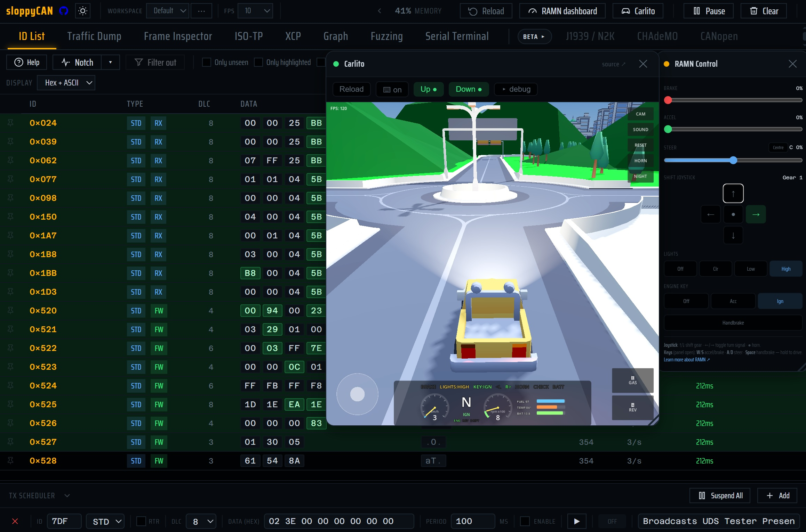

# SloppyCAN

Want to experiment with a CAN bus, but too lazy to install anything? SloppyCAN is here for you.

**[Try it online →](https://leaukojo.github.io/sloppycan/)**



## What it is

A browser-based CAN bus tool. No backend, no install, no build step, just open `index.html` and go.

- The classic CAN tools: live ID tables, traffic logging with CSV export, frame crafting,
  graphing, fuzzing.
- Diagnostics and industrial protocols: UDS, OBD-II, KWP2000, XCP, J1939/NMEA 2000/ISOBUS,
  CANopen, CHAdeMO.
- Drives [RAMN](https://github.com/ToyotaInfoTech/RAMN) and
  [Carlito](https://github.com/leaukojo/carlito) for a full sandbox: drive a car in a virtual
  world while a real, physical CAN bus carries the traffic.
- A 100% virtual **Demo** mode if you don't have hardware.
- Interactive explainers for learning CAN itself (arbitration, ISO-TP, bit-stuffing), like the
  [ISO-TP explainer](https://leaukojo.github.io/sloppycan/explainers/isotp-explainer.html).

## Requirements

- **Chrome or Edge** on desktop (Web Serial API for SLCAN; WebUSB for gs_usb).
  Android Chrome works for SLCAN via a WebUSB CDC fallback.
- A supported USB-to-CAN adapter: pick the type with the **Adapter** dropdown
  (`SLCAN` or `gs_usb`, e.g. candleLight / CANable / RAMN). gs_usb is WebUSB-only and classic
  CAN only (no CAN-FD).
- Or a remote TCP tunnel endpoint that forwards bytes SLCAN connection
  (python-can `socket://` style, raw SLCAN stream, no telnet negotiation).
- No hardware? Click **Demo** for a fully simulated bus.

## Running

Open `index.html` directly, everything except Carlito works straight from `file://`. To run a
modified version of Carlito, you will need to serve it locally with Python:

```
python -m http.server 8000 --bind 127.0.0.1      # then open http://localhost:8000/index.html
```

Web Serial requires a secure context (`file://`, `localhost`, or HTTPS), so reaching the page
from another device needs HTTPS set up in front of it, not plain `http.server`.

By default, the Carlito tab loads the hosted **stable** build of
[Carlito](https://github.com/leaukojo/carlito) — the promoted one, at
<https://leaukojo.github.io/carlito/stable/>. The **stable | dev** selector in the Carlito window
header switches to the dev channel (<https://leaukojo.github.io/carlito/dev/>, rebuilt on every
push), and the choice sticks via `localStorage`; `?carlitoBuild=dev` does the same from a link.

To point it at your own build instead (e.g. after modifying the game and re-exporting it), serve
the folder holding your build alongside SloppyCAN and open it with a `carlitoUrl` query param:
`http://localhost:8000/sloppycan/index.html?carlitoUrl=../carlito/build/web/index.html`. That
override replaces both channels (the selector hides while it is active) and also sticks via
`localStorage`, so you don't need to repeat it on later visits.

Demo mode simulates more protocols than a single real bus would carry at once, so each
diagnostic module (UDS, OBD-II, KWP2000, …) only generates traffic while its tab is open.

### Scripting

Your own scripts can join the bus live. Run `python scripting/sloppycan_relay.py` (stdlib only),
click **Script** (top right) and **Connect**, then run a script, e.g. `python scripting/example.py`. Scripts
see every frame sloppyCAN sees, and what they send is treated as a frame on the wire (and
transmitted when a bus is open). Any language works: the relay's TCP port `29541` speaks one
`cansend`-style line per frame (`123#DEADBEEF`), so `nc 127.0.0.1 29541` is a live candump.
Chrome asks once to allow local network access when the hosted page connects. Opened from
`file://`? Start the relay with `--allow-file-origin`. The relay accepts any `localhost` page on
any port by design, so any other local dev server you run can join it as well, and from there it
reaches the bus while sloppyCAN is connected.

### Remote SLCAN over TCP tunnel (`socket://` compatible)

Use the Adapter mode **SLCAN (socket tunnel)** to connect through a WebSocket endpoint that bridges
to a remote raw TCP SLCAN socket. The protocol is still plain SLCAN lines delimited by `\r` (`Sx`,
`O`/`L`, `C`, `t`/`T`/`r`/`R`) - no telnet commands/options are sent or expected.

Recommended boundary:

- Browser ⇄ **WebSocket tunnel endpoint**
- Tunnel endpoint ⇄ **remote raw TCP SLCAN socket** (the same stream python-can `slcanBus("socket://...")` uses)

Example with `websocat` on the machine that can reach the remote adapter:

```bash
websocat -E ws-l:127.0.0.1:29542 tcp:REMOTE_HOST:REMOTE_PORT
```

Then in SloppyCAN set the tunnel URL to `ws://127.0.0.1:29542/`.

> **Warning**: A WebSocket SLCAN listener exposed to a network allows anyone on that network to send CAN traffic — there is no authentication. Prefer binding the tunnel to localhost (`127.0.0.1`) or a tightly scoped private interface, and enforce an origin allowlist and TLS on any shared endpoint.

## Features

ID List, Traffic Dump, TX Scheduler, Frame Inspector, Graph, Fuzzing, and protocol tabs for
ISO-TP (UDS/OBD-II/KWP2000), J1939 (NMEA 2000/ISOBUS), CHAdeMO, XCP-on-CAN, and CANopen. Most
tabs are self-contained and work fully in Demo mode (only one base-traffic simulation runs at a
time; with Carlito open it follows the vehicle being driven, otherwise reload to switch back to
the default RAMN traffic).

Standalone protocol explainers (ISO-TP, OBD-II, UDS, KWP2000, NMEA 2000, ISOBUS, XCP, CANopen,
EV charging, a DTC decoder, and a CAN physical-layer walkthrough) live in
[`explainers/`](explainers/) and open from `file://` with no connection needed. Most are also
linked in-app via "Learn how … works ↗".

## Limitations / known work-in-progress

- Some features are still **beta**: auto-generated and not yet fact-checked against spec or
  real hardware.
- Not everything is cross-linked yet, e.g. OBD-II RPM isn't (yet) the same signal as Carlito's
  RPM when the two are connected.
- The Graph tab needs further performance work on large traces.
- **The trailer's ISO 11992 frames are not built from the standard.** ISO 11992-2 is paywalled,
  so the two identifiers (EBS21 = PGN 768, EBS22 = PGN 65220) come from secondary sources only.
  The trailer's axle load and brake demand aren't sent at all: no available source gives their
  scaling. [`iso11992.js`](js/iso11992.js) marks where each number came from. If you have the
  standard, a correction is very welcome.
- Android support works but isn't polished yet.
- Still needs more real-world user testing. Feedback and issues welcome.

## License

MIT, with one binding restriction: **this software may only be used with CAN bus testbeds,
bench setups, and simulators.** Connecting it to the CAN bus of a real, in-service, or occupied
vehicle, or any system that can affect the safety of people or property, is prohibited by the
license. See [`LICENSE`](LICENSE) for the full text.

## Contributing

The app core is `index.html` + `css/sloppycan.css` + `js/sloppycan.js`, with `can-link.js` (the USB/serial
transport) and `diag-parse.js` (OBD-II / UDS / KWP2000 decoders) beside it. Everything else is a
bolt-on module in its own script under `js/`; the ones the core calls are wired in through a few hooks tagged
*"remove to revert"*:

- **Tabs:** `graph.js`, `fuzz.js`, `j1939.js` (J1939 / NMEA 2000 / ISOBUS), `chademo.js`,
  `xcp.js`, `canopen.js`, `dronecan-core.js` + `dronecan.js`.
- **Carlito link and vehicle panels:** `carlito.js`, `ramn.js`, `vehicle-panel.js`, `drone.js`,
  `truck.js`, `tractor.js`, `boat.js`, `boat-pilot.js`, `train.js`, `plane.js`.
- **Protocol packers** (the game's signals as real frames): `isobus.js`, `j1939-flavor.js`,
  `nmea2000.js`, `cleanopen.js`, `iso11992.js`, `canaerospace.js`.
- **Scripting:** `script-link.js` (talks to `scripting/sloppycan_relay.py`).

See [`.claude/core-arch.md`](.claude/core-arch.md) and [`.claude/modules.md`](.claude/modules.md)
for architecture details, and [`CONTRIBUTING.md`](CONTRIBUTING.md) for how to file issues and
submit pull requests.

---

⚠️ SloppyCAN was built with Claude Code under human supervision
for testing and fact-checking, so review it yourself before relying on it. It's for **learning
CAN, not for connecting to real vehicles** (see [License](#license)).
