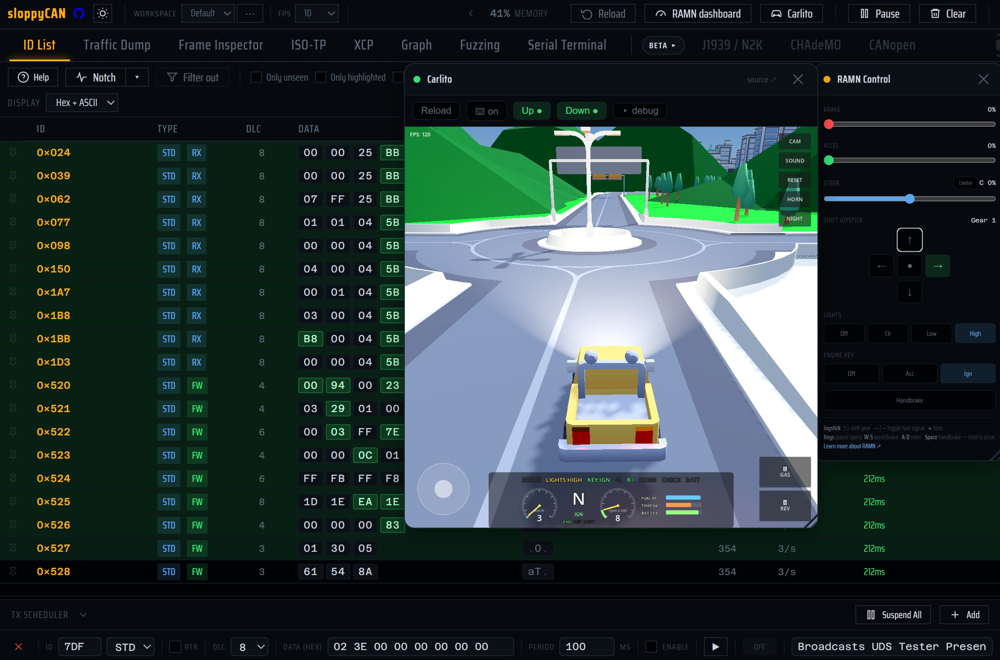

# SloppyCAN

Want to learn about the CAN bus, but too lazy to install anything?

SloppyCAN is a CAN tool that runs entirely in a web browser.

**Try it:** [https://leaukojo.github.io/sloppycan/](https://leaukojo.github.io/sloppycan/)



## Features

The classic CAN (Controller Area Network) software tools: dump CAN traffic, filter CAN messages, send CAN messages, graph specific bytes, etc.

SloppyCAN can be connected to [Carlito](https://github.com/leaukojo/carlito), a 3D driving simulator that also runs in a web browser.

You can use candlelight and slcan CAN adapters. If you own a [RAMN](https://github.com/ToyotaInfoTech/RAMN), you can connect it without installing anything and get started immediately. If you don't have any hardware, you can use the demo mode.

SloppyCAN's goal is to help people learn the CAN protocol. It features simulations of UDS, OBD-II, KWP2000, XCP, J1939 / NMEA 2000 / ISOBUS, CANopen and CHAdeMO.
It includes many interactive explainer pages (example: [ISO-TP explainer](https://leaukojo.github.io/sloppycan/explainers/isotp-explainer.html)).


## Requirements

**Chrome or Edge**. Android is partially supported.

## Running locally

Open `index.html` directly; everything except Carlito works straight from `file://`. To run a
modified version of Carlito, you will need to serve it locally with Python:

```
python -m http.server 8000 --bind 127.0.0.1      # then open http://localhost:8000/index.html
```

By default, the Carlito tab loads the hosted **stable** build of
[Carlito](https://github.com/leaukojo/carlito) (the promoted one, at
<https://leaukojo.github.io/carlito/stable/>). The **stable | dev** selector in the Carlito window
header switches to the dev channel (<https://leaukojo.github.io/carlito/dev/>); `?carlitoBuild=dev` does the same from a link.

To point it at your own build instead (e.g. after modifying the game and re-exporting it), serve
the folder holding your build alongside SloppyCAN and open it with a `carlitoUrl` query param:
`http://localhost:8000/sloppycan/index.html?carlitoUrl=../carlito/build/web/index.html`.

### Scripting

You can run local scripts that read and write CAN messages from SloppyCAN. Run `python scripting/sloppycan_relay.py`,
click **Script** (top right) and **Connect**, then run a script, e.g. `python scripting/example.py`. Scripts
see every frame sloppyCAN sees, and what they send is transmitted when a bus is open.

The relay's TCP port `29541` uses `cansend`-style lines (`123#DEADBEEF`), so `nc 127.0.0.1 29541` is a live candump.
Chrome will ask once to allow local network access when the hosted page connects.

When opening the page from `file://`, start the relay with `--allow-file-origin`.

### Remote SLCAN over TCP tunnel (`socket://` compatible)

Use the Adapter mode **SLCAN (socket tunnel)** to connect through a WebSocket endpoint that bridges
to a remote raw TCP SLCAN socket. The protocol is still plain SLCAN lines delimited by `\r` (`Sx`,
`O`/`L`, `C`, `t`/`T`/`r`/`R`); no telnet commands/options are sent or expected.

Recommended boundary:

- Browser ⇄ **WebSocket tunnel endpoint**
- Tunnel endpoint ⇄ **remote raw TCP SLCAN socket** (the same stream python-can `slcanBus("socket://...")` uses)

Example with `websocat` on the machine that can reach the remote adapter:

```bash
websocat -E ws-l:127.0.0.1:29542 tcp:REMOTE_HOST:REMOTE_PORT
```

Then in SloppyCAN set the tunnel URL to `ws://127.0.0.1:29542/`.

> **Warning**: A WebSocket SLCAN listener exposed to a network allows anyone on that network to send CAN traffic — there is no authentication.
> Prefer binding the tunnel to localhost (`127.0.0.1`) or a tightly scoped private interface, and enforce an origin allowlist and TLS on any shared endpoint.

## Limitations / known work-in-progress

- Some features are still **beta**: auto-generated and not yet fact-checked against spec or
  real hardware.
- Not everything is cross-linked yet, e.g. OBD-II RPM isn't (yet) the same signal as Carlito's
  RPM when the two are connected.
- Still needs more real-world user testing. Feedback and issues welcome.

## License

MIT, with one binding restriction: **this software may only be used with CAN bus testbeds,
bench setups, and simulators.** Connecting it to the CAN bus of a real, in-service, or occupied
vehicle, or any system that can affect the safety of people or property, is prohibited by the
license. See [`LICENSE`](LICENSE) for the full text.

---

⚠️ SloppyCAN was built with Claude Code under human supervision for testing and fact-checking, so review it yourself before relying on it.
